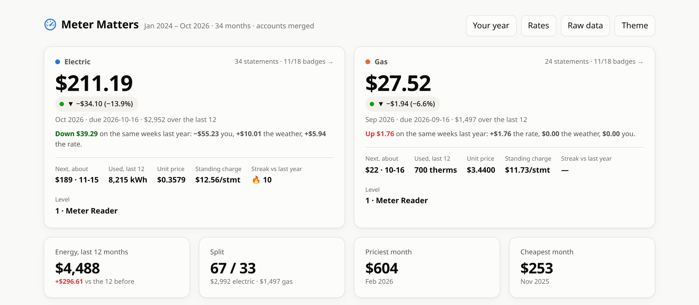
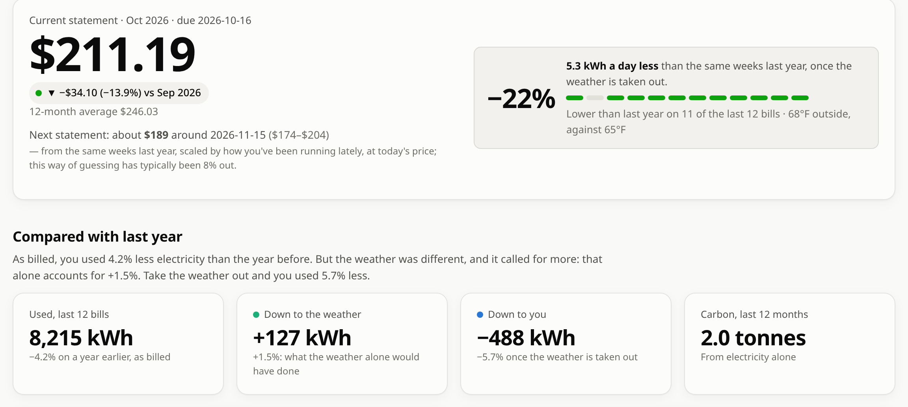
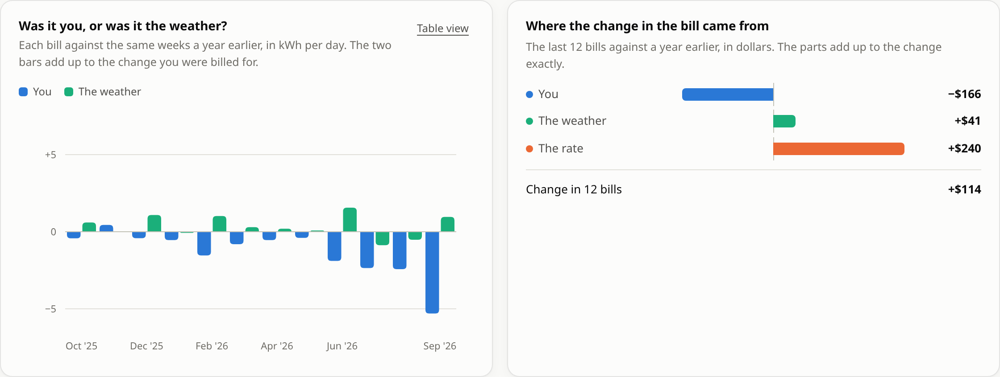
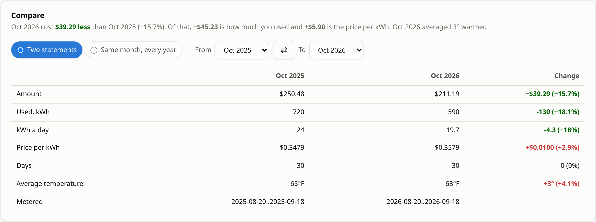
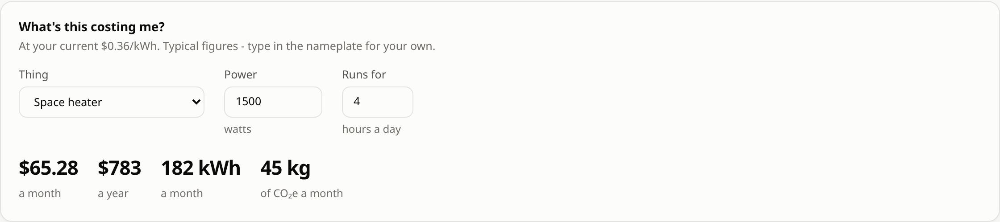
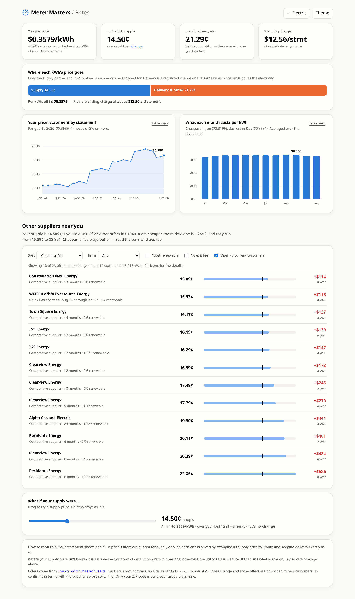
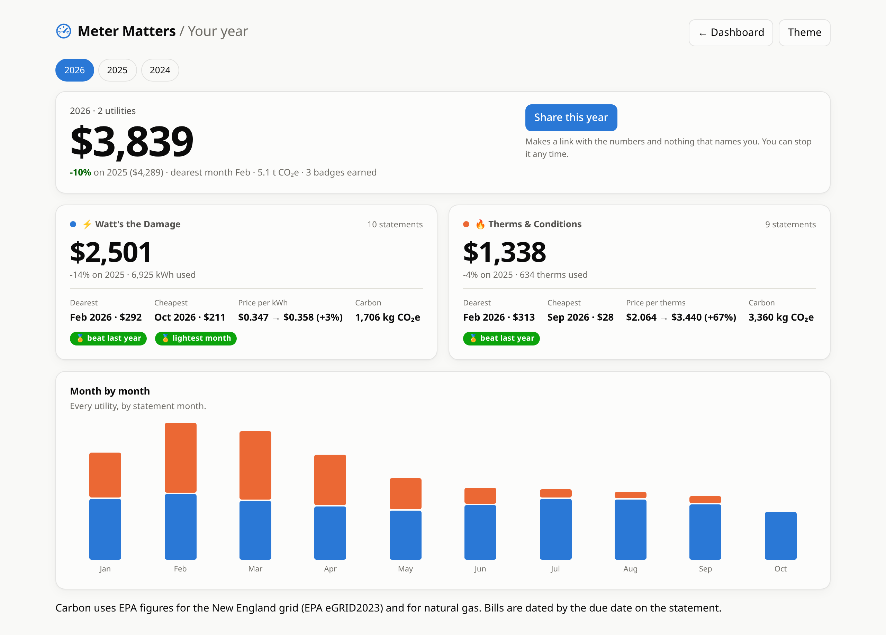
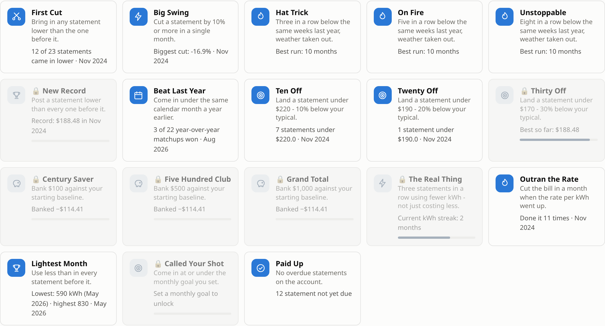
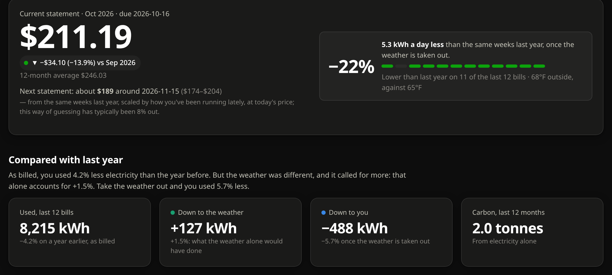

# Meter Matters

**See what your utility bills actually did, and use less.**
Live at [metermatters.app](https://metermatters.app).

Upload the files your electric, gas or water company already gives you and
Meter Matters turns them into something you can act on: how this period
compares with the same weeks last year *with the weather taken out*, when your
usage stepped to a new level and what that step costs, where the price per
unit is going, what your next statement will probably be, and a game of
streaks and badges that only rewards bills that genuinely went down.

The electric page answers to ⚡ *Watt's the Damage*, the gas page to
🔥 *Therms & Conditions*, and the water page to 💧 *Tapped Out*.



*Every screenshot here is the app on the invented "Pat Sample" household in
`fixtures/synthetic/`. No real bills.*

## What it does

- **Any utility, any US state.** Green Button XML, any CSV (columns are matched
  by name and you are asked when it cannot tell), or bills typed in by hand.
  Eversource's own exports and bill emails are read directly.
- **Weather taken out.** Each home's own heating balance point and
  degrees-to-fuel slope are fitted from its history, so a cold winter is not
  mistaken for a wasteful one. Temperatures come from Open-Meteo, by ZIP code
  only.
- **Was it you, the weather, or the rate?** Every change in a bill is split
  exactly into those three parts, and they add up to the change as billed.
- **Something changed.** Steps in usage that the weather does not explain are
  found, sized and priced. Name one ("new heat pump") and it stops being flagged.
- **Next statement forecast**, with a range that is the method's own
  backtested error, not a guess.
- **Compare any two statements**, or one calendar month across every year.
- **Price per unit taken apart**, with a supplier comparison for Massachusetts
  from Energy Switch MA.
- **Carbon**, on the grid factor for the home's state (EPA eGRID 2023).
- **"What's this costing me?"** A space heater, EV charging, a dripping tap,
  priced at your own rate.
- **Similar homes.** How your use per day sits against other homes in your
  state on the same fuel, shown only once there are enough of them to be
  anonymous; opt out any time.
- **Your energy year**, with a public share link and an image card.
- **More than one home** per account, each fully separate.
- **A fair game.** Streaks, levels and 18 badges. A streak counts only
  statements that beat the same weeks last year after the weather is taken out,
  and falls back to plain usage, then dollars, saying which it used.
- **Solar / net metering.** Delivered and exported energy are kept apart, never
  netted. Credit bills are kept and marked.

## A look around

**A fuel page.** The current statement, what the next one will probably be,
and the comparison with the same weeks last year once the weather is taken
out.



**Was it you, or was it the weather?** Each bill against a year earlier, split
into the two, and the last twelve in dollars with the rate as a third part.
The parts add up to the change exactly.



**Compare any two statements**, or one calendar month across every year on
file. The cost change is split into the usage part and the rate part.



**What's this costing me?** Presets for the usual suspects, priced at your own
rate and on your own grid's carbon factor.



**Rates.** Your all-in price taken apart into supply and delivery, its history,
and every supplier offer for your ZIP priced against your own last twelve
months.



**Your energy year**, with a share link that carries the numbers and nothing
that names you.



**The game.** Eighteen badges, each showing its rule and live progress. Locked
ones say what's left to do.



It follows the system light or dark setting, with a manual override.



## Pages

| Route | What |
|---|---|
| `/` | Every utility side by side: forecast, weather / rate / you split, alerts, carbon, total spend |
| `/electric`, `/gas`, `/water` | One fuel in full: vs last year, what changed, compare, calculator, history, the game |
| `/year`, `/year/<y>` | Your energy year; `/s/<token>` is its public share page |
| `/rates` | Price per unit over time, split into supply and delivery, and offers nearby |
| `/homes` | Every home added up (appears once there are two) |
| `/home/<name>/…` | Any page, for another home |
| `/connect` | Add bills: upload, forward, Gmail, by hand; about this home; manage homes |
| `/raw` | Every record, filterable, exportable as CSV |
| `/test-suite` | The results of the test run that shipped with the running code |

## Run it locally

```bash
./run.sh                 # creates .venv on first run, serves on http://127.0.0.1:5000
PORT=5137 ./run.sh       # a different port
```

With no `ELEC_SECRET_KEY` set that is one person on localhost with no sign-in,
and the data lives in the checkout (`data/`, `usage/`, `AccountHistory.csv`,
all gitignored). Setting `ELEC_SECRET_KEY` turns accounts on.

Python 3.13 (what the image runs; 3.12 works too). Dependencies are in
`requirements.txt`; there is no front-end build step (plain ES modules and a
small SVG chart library).

## Getting bills in

From the **Add bills** page, or by dropping files on any dashboard:

| You have | What happens |
|---|---|
| Green Button XML | Interval readings summed by month. Units come from the file; an unknown unit is refused, never guessed. Solar exports are kept separate |
| A usage export with costs | Read and filed. With no bill history, a statement is made from each period and marked as an estimate |
| A bill history CSV | Each row becomes a statement |
| Any other spreadsheet | Columns are matched by name. If it cannot tell what is what, it shows a sample and asks |
| Nothing to upload | Type a bill in, with the usage if you have it |

Bills can also arrive on their own, when the operator has configured it:

- **Forwarding.** Each user gets a private `bills-<token>@…` address; a filter
  in their mailbox forwards the utility's notices there. Mailgun, Postmark and
  raw webhooks are supported, and the utility's DKIM signature is checked.
- **Gmail.** *Import once* (access handed straight back) or *stay connected*
  (an encrypted refresh token, until disconnected).

Usage data (kWh, therms, gallons) only ever arrives by upload: no utility
offers an individual a feed for it.

## Where things are

```
metermatters/              the app, one package
  config.py                paths and settings, all from the environment
  fuels.py                 Electric / Gas / Water defined once: units, slugs, taglines
  region.py                a home's state; EPA eGRID carbon factors
  testreport.py            runs the suite and writes test-report.json for /test-suite
  analytics/               the numbers
    analysis.py            bill parsing and the maths; no Flask
    insights.py            vs last year with the weather out, steps, carbon, tips
    forecast.py            the next statement and its backtested range
    yearly.py              the year page, share tokens, the SVG card
    benchmarks.py          similar homes: per-state buckets, salted hashes, opt-out
    rates.py               price per unit taken apart; Energy Switch MA offers
    weather.py             daily temperatures for a place, fetched once and kept
    gamify.py              levels, streaks and badges
  intake/                  getting bills and usage in
    importers.py           any CSV or Green Button XML; bills by hand
    greenbutton.py         Eversource's usage export, with the degree-day fit
    ingest.py              merge and de-duplicate, shared by upload and CLI
    billmail.py            the bill-ready email (.eml or IMAP)
    inbound.py             bills arriving by forwarded email
    gmail_sync.py          importing from a connected mailbox
    backfill.py            extend bill history backwards from usage
    import_bill.py         CLI: python -m metermatters.intake.import_bill
  store/                   where things are kept
    db.py                  Postgres (Supabase) when hosted, SQLite otherwise; migrations
    workspace.py           a user's files, on disk or in the database
    accounts.py            users, argon2id passwords, sessions
    homes.py               more than one home: names, routing, delete / restore
    storage.py             atomic writes and the merge lock
    secrets_box.py         encryption for a kept Gmail token
  web/                     the Flask app
    app.py                 dashboard routes, the report every page is built from
    connect.py             sign-in, Add bills, Google and inbound-email routes
    google_oauth.py        Google sign-in and the Gmail API
    static/                ES modules per page; charts.js is the SVG chart library
    templates/             Jinja pages
  tasks/                   jobs.py (the daily check), watchdog.py, notify.py
tests/                     the suite; support.py is the shared scaffolding
  fixtures/synthetic/      invented data with the real shape; what a clean checkout tests against
scripts/portal.py          drives a desktop browser to fetch exports; never shipped
wsgi.py, gunicorn.conf.py  the production entry point
deploy/                    Cloud Run deploy script, Cloud Build pipeline, privacy check
docs/                      the long-form reference and the screenshots
systemd/                   a single-machine mailbox timer from before the hosted app
```

Modules that double as commands run with `-m`: `python -m metermatters`
is the dev server, `python -m metermatters.store.accounts list` lists users,
`python -m metermatters.intake.import_bill --file export.csv` imports one.

## Tests

```bash
.venv/bin/python -m unittest discover -s tests -t .
python -m metermatters.testreport     # the same, written to test-report.json
```

Around 600 tests run on invented homes whose answers are known. Nothing
leaves the machine: the weather service, Google and the comparison sites are
all replaced. The database tests need a Postgres to point at:

```bash
ELEC_TEST_DATABASE_URL=postgresql://postgres:pw@127.0.0.1:55432/postgres
```

They delete that database's tables, so `tests/support.py` refuses anything
that is not local. The deploy script starts a throwaway `postgres:16` in Docker for
exactly this.

## Deploying

The hosted app is a container with no disk: every account, statement and
upload lives in Postgres. It runs on Google Cloud Run with Supabase as the
database, but nothing ties it to either.

```bash
export PROJECT=my-gcp-project REGION=us-central1
./deploy/cloudrun.sh secrets      # once: prompts for the secrets, straight into Secret Manager
cp deploy/cloudrun.env.example deploy/cloudrun.env
./deploy/cloudrun.sh deploy       # runs the tests, builds, deploys, ships the test report
./deploy/cloudrun.sh schedule     # once: Cloud Scheduler runs the daily check
```

Anywhere else: `docker build -t meter-matters .` and run it with a volume at
`/data` and `ELEC_SECRET_KEY` set. [deploy/README.md](deploy/README.md) covers
the Cloud Build pipeline, rolling back and reading build logs.

### Configuration

Everything is an environment variable; `.env.example` lists them all with
comments. Anything unset switches its feature off.

| Variable | Does |
|---|---|
| `ELEC_SECRET_KEY` | signs sessions; turns accounts on. Required when hosted |
| `ELEC_BASE_URL` | the address the app is served at |
| `ELEC_DATABASE_URL` | Postgres connection string. Required on Cloud Run |
| `ELEC_DATA_DIR` | where data lives when there is no database |
| `ELEC_ALLOW_SIGNUP` | `0` to close sign-ups |
| `ELEC_GOOGLE_CLIENT_ID`, `ELEC_GOOGLE_CLIENT_SECRET`, `ELEC_TOKEN_KEY` | Google sign-in and Gmail |
| `ELEC_INBOUND_DOMAIN`, `ELEC_INBOUND_SECRET`, `ELEC_MAILGUN_SIGNING_KEY`, `ELEC_INBOUND_DKIM` | forwarding |
| `ELEC_TASK_TOKEN` or `ELEC_SCHEDULER=1` | who runs the daily check |
| `ELEC_WEATHER=off` | no weather lookups |
| `ELEC_TRUSTED_PROXIES` | proxies in front of the app (default 1) |

## Privacy

- Bills carry your name, address and account number. Every file that can hold
  them is gitignored, `.dockerignore` and `.gcloudignore` are allow-lists so
  nothing personal can reach an image by being forgotten, and
  `./deploy/privacy-check.sh` searches everything git would commit for your
  own name, address, account numbers and secret values before you push.
- What leaves the server: a ZIP code to Open-Meteo, a ZIP code to Energy
  Switch MA when you ask for offers, and your mail to Google only when you
  connect it. Never an address.
- Passwords are argon2id hashes. Sessions are signed, `HttpOnly`, `SameSite`
  cookies. A kept Gmail token is encrypted with a key held outside the database.
- *Delete this account* removes every bill, export, share link and benchmark
  row, and hands back any Gmail grant.

## Status and limits

- Supplier comparison covers Massachusetts only. Another state is one reader
  against its public comparison site plus one line in `rates.COVERED`; Texas,
  Pennsylvania, Ohio, Illinois, Connecticut, New York and Maryland all have one.
- Bill emails are read for Eversource only. Everyone else uploads or types.
- Green Button XML is read one fuel per file.
- No password reset or email confirmation yet: both need outgoing mail, and
  the app does not currently email users at all.
- Open-Meteo's free tier is for non-commercial use.

More depth on all of it, including how each number is defined, is in
[docs/how-it-works.md](docs/how-it-works.md).
